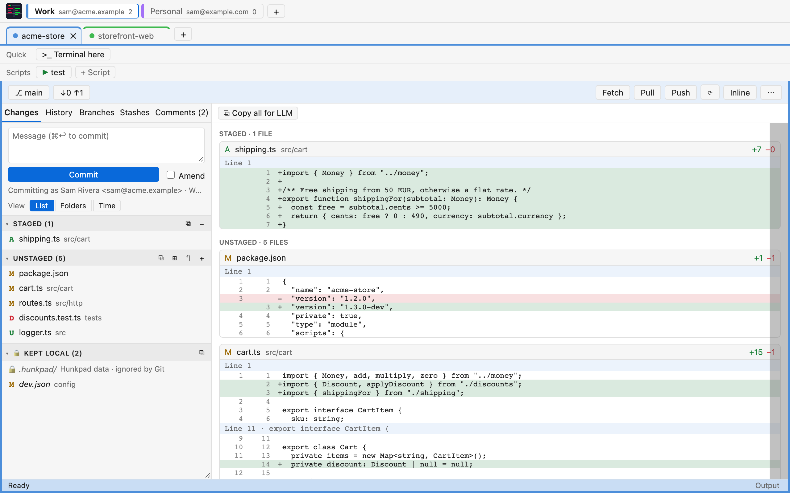
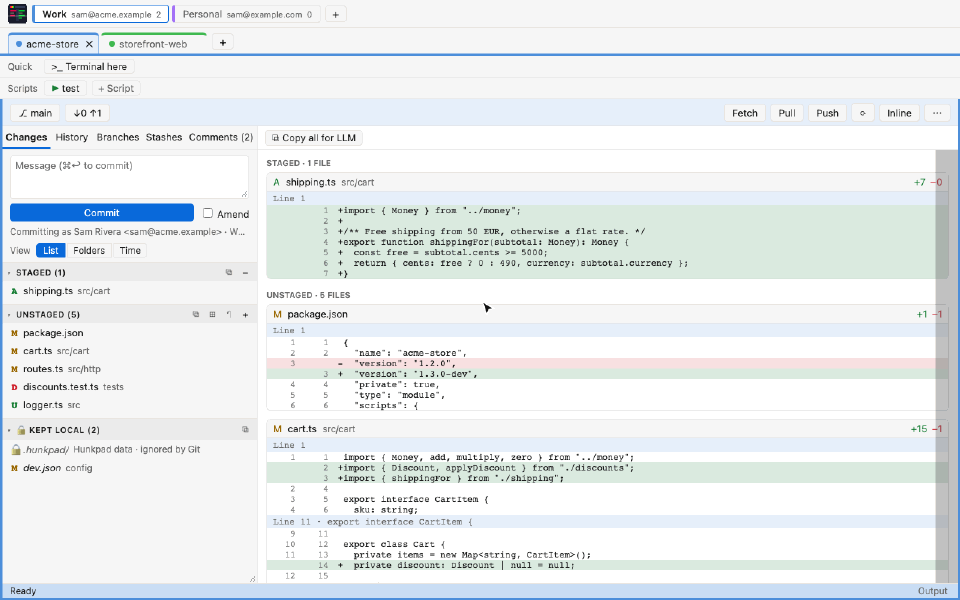
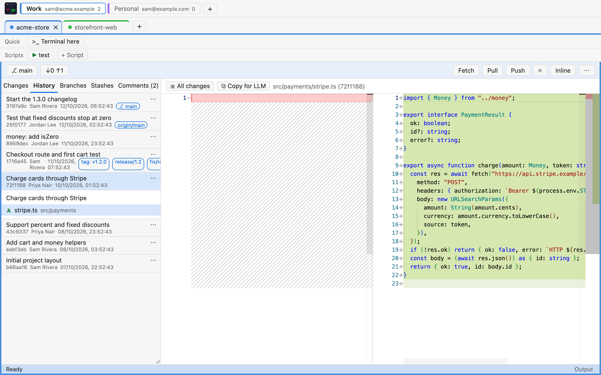
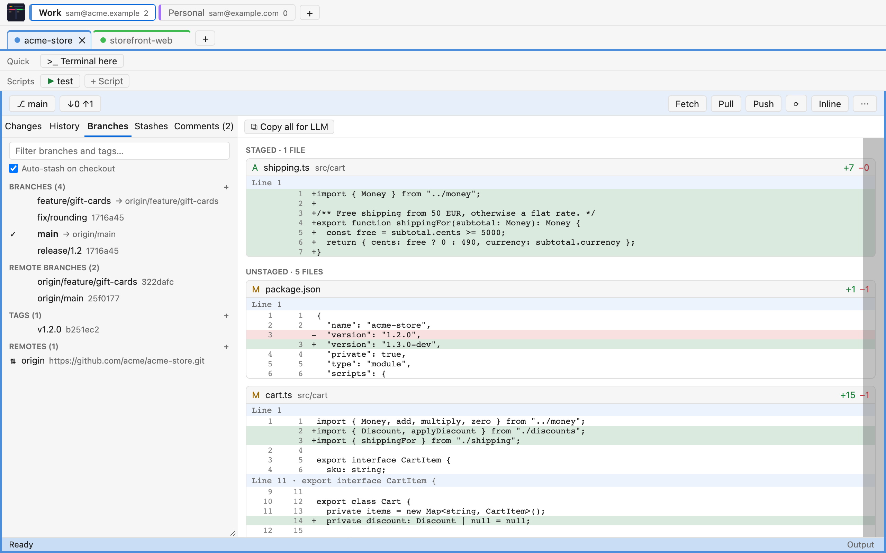
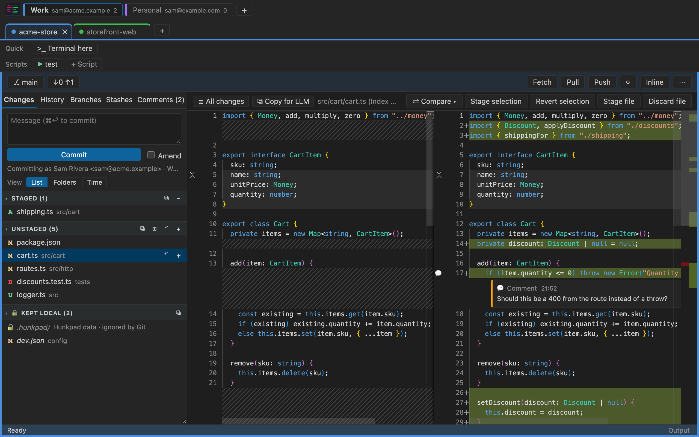
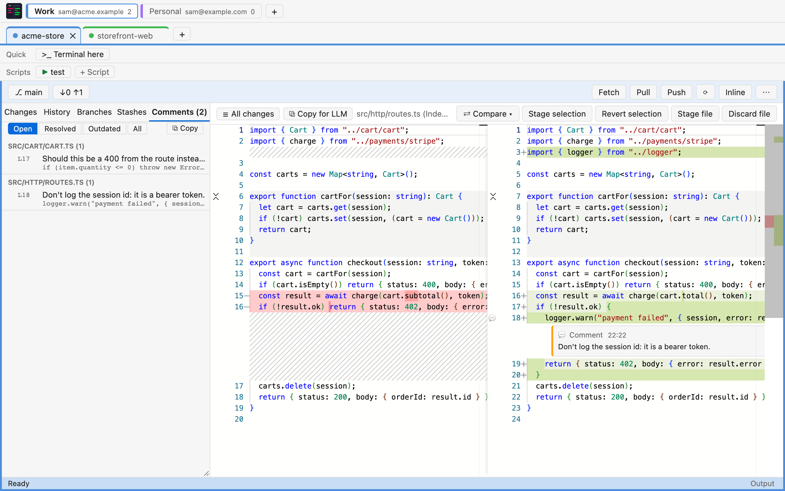

  

<h1 align="center">Hunkpad</h1>

  <b>A lightweight, free and open-source Git client with VS Code-quality diffs.</b> 
  Stage single lines, review your own changes, and see every Git command before it runs. 
  Windows · macOS · Linux

  
  
  
  

  

Hunkpad is built with [Tauri 2](https://tauri.app/) (Rust and the system's own
WebView) and the [Monaco](https://microsoft.github.io/monaco-editor/) diff
editor, the same diff component VS Code uses. It runs the `git` command line you
already have, so it behaves exactly like Git in a terminal: your config, hooks
and credential manager included. No accounts, no telemetry, a small download.

**[⬇ Download the latest release](https://github.com/AleB93/Hunkpad/releases/latest)**

## Highlights

### Stage exactly the lines you mean

Put the cursor in a change (or select some lines) and **Stage selection**. The
rest of the file stays unstaged. *Revert selection* and *Unstage selection* work
the same way.

### See every Git command before it runs

Every action that changes something shows the exact command line, what it does
(destructive ones in red), the folder and any input such as the commit message.
Cancel stops the whole action. Turn it off in ⋯ → *Ask before Git commands*.

### Review your own changes, then hand them to an LLM

Comment any line of a diff. Comments follow their line as code moves, and are
listed by file in the **Comments** tab. **Copy for LLM** puts the diff and its
comments in one Markdown file, ready to paste into a chat.

### Optional: let Claude help (off by default)

With the [Claude Code](https://claude.com/claude-code) command line installed
and signed in, turn on **⋯ → Claude features…**. Hunkpad runs your own
`claude` (no key or account in Hunkpad) to:

- **✨ draft a commit message** (the ✨ in the message box) from the staged changes, or a group's changes;
- **✨ Organize** unstaged changes into groups, each with a commit message;
- **review** your changes, adding its findings as review comments;
- **describe a branch** for a pull request, or **explain** a commit (History);
- **suggest a resolution** for a merge conflict, written only when you accept it.

Each request shows exactly what will be sent first. Claude gets no tools: it
only reads that text and answers, and every Git command still goes through
Hunkpad. Kept local and secret-looking files (`.env`, keys, credentials) are
never sent, and a request is refused if the text looks like it holds a token.

### Optional: let Claude Code use Hunkpad (MCP)

The other way round: while you work with Claude Code in a terminal or IDE, it
can see what Hunkpad shows and use it. Turn on **⋯ → Claude Code can use
Hunkpad (MCP)…**; Hunkpad starts a local MCP server and adds it to Claude Code
for you (`claude mcp add --scope user`). Then ask Claude things like *"look at
what I have open in Hunkpad"* or *"split my changes into groups"*.

| Tool | Does |
| --- | --- |
| `hunkpad_get_view` | active repo, open file, cursor and selection, side tab |
| `hunkpad_list_changes` | staged, unstaged blocks with their groups, Kept local, conflicts |
| `hunkpad_create_group` · `update_group` · `delete_group` · `set_active_group` | manage change groups |
| `hunkpad_assign_blocks` | move change blocks between groups |
| `hunkpad_list_comments` · `add_comment` · `resolve_comment` | review comments |
| `hunkpad_open_file` | show a file (at a line) in Hunkpad |
| `hunkpad_stage_group` · `commit_group` | stage or commit one group, **after you approve the Git command in Hunkpad** |
| `hunkpad_switch_repo` | switch to another open tab |

The server listens on `127.0.0.1:47821` only and needs a secret token (stored
in Hunkpad's settings and in Claude Code's config); requests from web pages
are refused. Hunkpad must be running for Claude to reach it. **⋯ → MCP: new
token** replaces the token and re-adds the entry.

### And the rest of a daily Git client

| | |
| --- | --- |
|  |  |
| **History**: every commit's files and diffs; checkout, cherry-pick, revert, reset. | **Branches & tags**: favourites, filter, merge, rebase with auto-stash, remotes. |
|  |  |
| **Light and dark** follow the OS. Side by side or inline diffs. | **Comments**: open, resolved and outdated, grouped by file. |

## All features

- **Changes**: staged / unstaged / conflicted files, live refresh via a file
  watcher; stage, unstage, discard per file or all.
- **Line-level staging**: put the cursor in a change (or select lines) and
  *Stage selection*, *Revert selection* or *Unstage selection*.
- **Commit**: commit, amend, "stage all and commit" when nothing is staged.
- **Merge / rebase / cherry-pick / revert in progress**: banner with
  Continue / Skip / Abort; conflicts with Accept current / incoming / Mark resolved.
- **History**: paged log; per commit: changed files with diffs, checkout,
  branch/tag here, cherry-pick, revert, reset (soft/mixed/hard).
- **Compare with a branch**: ⇄ Compare in the diff toolbar (or Branches →
  right-click → Compare my files with this): every changed file then opens as
  that branch's version ↔ your file on disk (upstream, recent refs, or any
  branch/tag/commit). The "⇄ vs origin/dev ✕" pill shows it and turns it off.
- **Branches & tags**: filter (multi-word, Enter checks out a single match),
  favourites (★, per repo, shown first), checkout (incl. remote tracking), create,
  rename, delete, merge, rebase onto (with "Fetch first" = pull --rebase, and
  "Auto-stash" uncommitted changes; warns when pushed commits get rewritten),
  delete remote branch, push tag.
- **Stashes**: stash (optionally with untracked), apply, pop, drop, view files.
- **Remotes**: list, add, change URL, rename, remove (Branches tab → Remotes,
  ⋯ → Add remote…; Publish offers to add one when there is none). Fetch, pull
  (merge or rebase), push / publish, force push with lease, sync (↓ behind ↑ ahead).
- **All changes overview**: with no file selected, the diff area lists every
  changed file (Staged, then Unstaged, new files included) showing only its
  changed chunks with 3 lines of context. Click a file or line to open its diff;
  **☰ All changes** or Esc goes back.
- **View: List / Folders / Time**: arranges files inside every section: a
  folder tree (single-child folder chains compacted, collapsible) or buckets by
  last save on disk (last 5 min, 30 min, hour, today, yesterday, 7 days, older).
- **Change groups** (block level, like IntelliJ partial changelists): local-only
  "waves" of work. Each unstaged change *block* belongs to a group, so one file
  can be split across groups (badge `2/3`). New blocks go to the **active** group
  (● marker; ⊞ makes a new group active). Move a block from its diff
  (**Move change ▾**), or a file's blocks by drag & drop or the row menu.
  **Commit group** commits only its blocks, built in a temporary index in the OS
  temp folder: other staged work stays staged, hooks run.
- **Markdown preview**: `.md` files open rendered (GitHub-flavoured: tables,
  task lists, code blocks); 👁 Preview / ⇆ Diff switches. Repo links open the
  file here, web links open in the browser, repo images show inline, remote
  images become links. The HTML is sanitised: nothing in a file can run.
- **Search**: Ctrl+P finds a file by name, Ctrl+Shift+F finds text in all files
  (`git grep`, no index), Ctrl+click on a word lists where it is used.
- **Review comments**: comment any line on the right side of a diff (hover →
  ＋ in the margin, right-click → Add comment, or Ctrl+Alt+M). A **Comments** tab
  lists them by file (Open / Resolved / Outdated / All). Comments follow their
  line as code moves and become "outdated" when the line is gone.
- **Copy for LLM**: plain Markdown (no prompt text): repo/branch/scope header,
  one fenced diff per file with its status, then that file's comments. From the
  diff toolbar, the ⧉ on Staged/Unstaged/Kept local, group and file menus, a
  commit's menu (message + diff) and the Comments tab. Kept local files are left
  out of broad copies (they often hold local secrets). On Windows and macOS it
  copies a **.md file** (like copying a file in Explorer or Finder), so pasting
  into a chat attaches it instead of a wall of text; ⋯ → "Copy for LLM as:
  file · text" switches to plain text. On Linux it always copies text.
- **Asks before every Git command** that changes something: shows the action,
  the exact command line, what it does (destructive ones in red), the folder and
  any input (e.g. the commit message). Cancel stops the whole action. Toggle:
  ⋯ → Ask before Git commands.
- **Kept local**: files whose changes stay on this machine and are never staged
  or committed (e.g. local settings), without touching `.gitignore`.
- **Scripts row**: per repository, add an existing script or an npm script and
  run it with one click in a new terminal window, in the repository folder (see
  [Scripts](#scripts)).
- **Git users**: a first row of tabs (Work, Personal…), each with its own commit
  author name/email and its own repository tabs. The identity is passed as
  `git -c user.name=… -c user.email=…`, so repo config is never written.
- **Repository tabs**: one tab per open repo, a colour per tab framing the whole
  window, tabs restored on start.
- **Projects**: every opened repo is remembered; pin, rename, remove; quick
  picker with search.
- **Clone**, output log of every Git command, light/dark theme from the OS.

## Install

Download the installer for your system from the
**[latest release](https://github.com/AleB93/Hunkpad/releases/latest)**:

| System | File |
| --- | --- |
| Windows 10/11 | `Hunkpad_x.y.z_x64-setup.exe` (or the `.msi`) |
| macOS, Apple Silicon | `Hunkpad_x.y.z_aarch64.dmg` |
| macOS, Intel | `Hunkpad_x.y.z_x64.dmg` |
| Linux | `.AppImage`, `.deb` or `.rpm` |

Hunkpad needs **Git** installed (it tells you how if it is missing):

- **Windows**: [Git for Windows](https://git-scm.com/download/win).
- **macOS**: run `xcode-select --install` in Terminal, or `brew install git`.
- **Linux**: your package manager, e.g. `sudo apt install git`.

The installers are not code-signed yet:

- **Windows**: SmartScreen may warn that the app is from an unknown publisher:
  click **More info → Run anyway**.
- **macOS**: if macOS refuses to open it, go to **System Settings → Privacy &
  Security** and click **Open Anyway** (once).

To build it yourself, see [CONTRIBUTING.md](CONTRIBUTING.md#build).

## Keyboard shortcuts

On macOS, use ⌘ wherever Ctrl is listed (Ctrl+Tab stays Ctrl).

| Shortcut         | Action                                  |
| ---------------- | --------------------------------------- |
| Ctrl+R           | Projects (quick picker with search)     |
| Ctrl+P           | Find a file by name                     |
| Ctrl+Shift+F     | Find text in all files (selection prefilled) |
| Ctrl+click       | On a word in the diff: find where it is used |
| Shift+F12        | Same, for the word at the cursor        |
| Ctrl+O           | Open a repository                       |
| Ctrl+W           | Close the current repository tab        |
| Ctrl+Tab         | Next tab (Shift for the previous one)   |
| Ctrl+Enter       | Commit (in the message) / save comment  |
| Ctrl+Alt+M       | Comment on the current line             |
| F5               | Refresh                                 |
| Esc              | Close a menu, or back to All changes    |

## Scripts

Scripts run in a new terminal window, in the repository's folder, which stays
open afterwards so the output can be read.

- **Windows**: `.ps1` with PowerShell, `.cmd`/`.bat` with cmd, `.sh` with Git
  Bash, `.py` with python, `.js` with node; other files with their default program.
- **macOS and Linux**: `.sh` with bash, `.zsh` with zsh, `.py` with python3,
  `.js` with node, `.ps1` with pwsh; other files must be executable (`chmod +x`).
  macOS uses Terminal (or whichever app opens `.command` files). Linux uses
  `$TERMINAL` if set, otherwise the first terminal found (GNOME Terminal,
  Konsole, xfce4-terminal, Alacritty, kitty, xterm…).
- **npm scripts**: choose a `package.json` (at the root or in a subfolder such
  as `app/`) and pick one of its scripts. It runs as `npm run <script>` in that
  `package.json`'s folder.

## Use from your IDE

Pass a repository path to open it: `hunkpad "<repo path>"`. With no argument it
reopens the last repository. For example, in Visual Studio: Tools → External
Tools, command `hunkpad.exe`, arguments `$(SolutionDir)`. On macOS:
`open -a Hunkpad --args "<repo path>"`.

## Privacy and where data is stored

Hunkpad has no telemetry, no accounts and no update checks. The only network
traffic is what Git itself does (fetch, pull, push, clone), opening the Git
download page if you click it, and, only if you turn the Claude features on,
the requests you send through your own `claude` command line.

- **Per repository**: `<repo>/.hunkpad/state.json` holds the tab colour,
  favourite branches/tags, change groups, Kept local list, scripts and review
  comments. `.hunkpad/.gitignore` contains `*`, so Git ignores the whole folder:
  it is never committed, and the repository's own `.gitignore` is not touched.
- **App-wide**: `settings.json` holds Git users, open tabs, saved projects and
  preferences. It lives in:
  - Windows: `%APPDATA%\io.github.aleb93.hunkpad\`
  - macOS: `~/Library/Application Support/io.github.aleb93.hunkpad/`
  - Linux: `~/.config/io.github.aleb93.hunkpad/`
- **Temporary files**: Copy for LLM files go to the OS temp folder
  (`hunkpad-exports`) and are deleted after 7 days.

## Known limitations

- Line-level actions are disabled for binary and non-UTF-8 files.
- A change that only adds/removes the final newline cannot be staged by line;
  stage the whole file instead.
- No blame, no graph view, no submodule management yet.
- On Linux, very large repositories can exceed the system's file-watch limit;
  Hunkpad then says how to raise it, and F5 refreshes in the meantime.

## Contributing

Bug reports and pull requests are welcome: see [CONTRIBUTING.md](CONTRIBUTING.md).

## License

[MIT](LICENSE)
